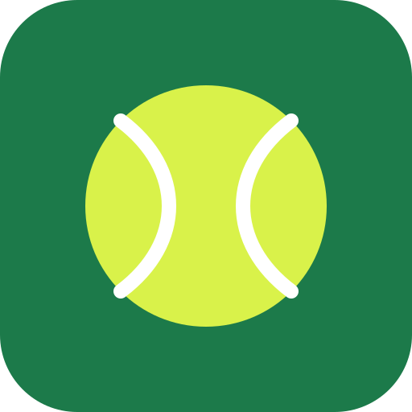
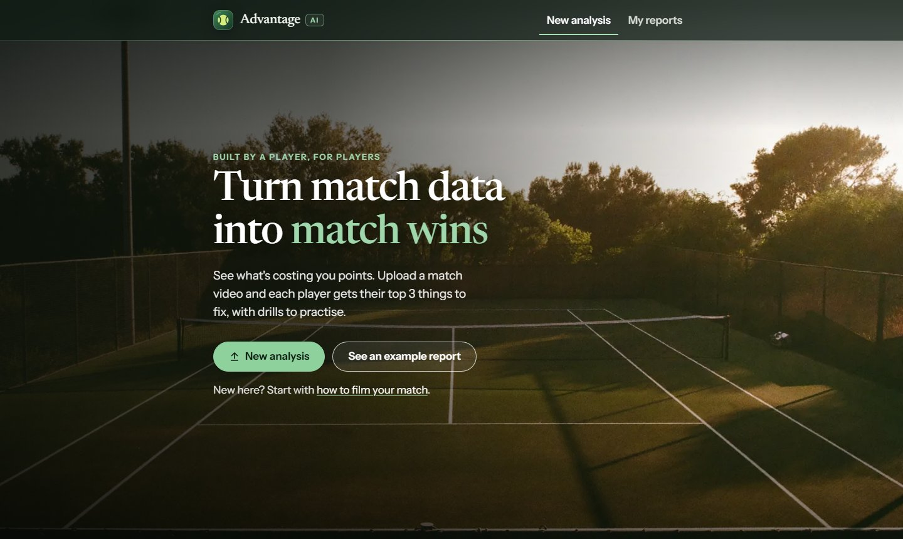
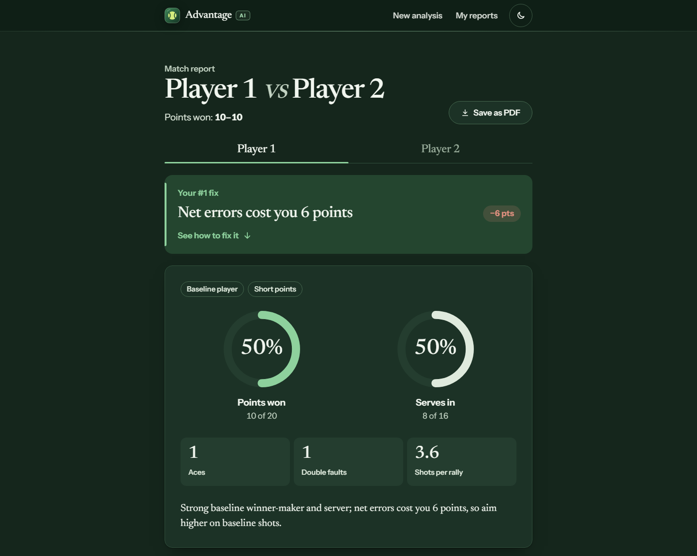
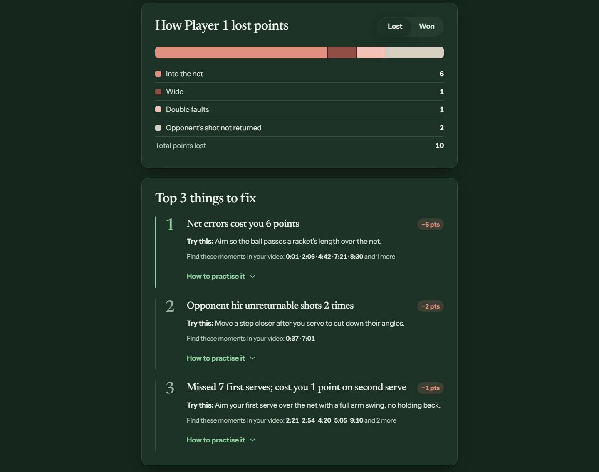
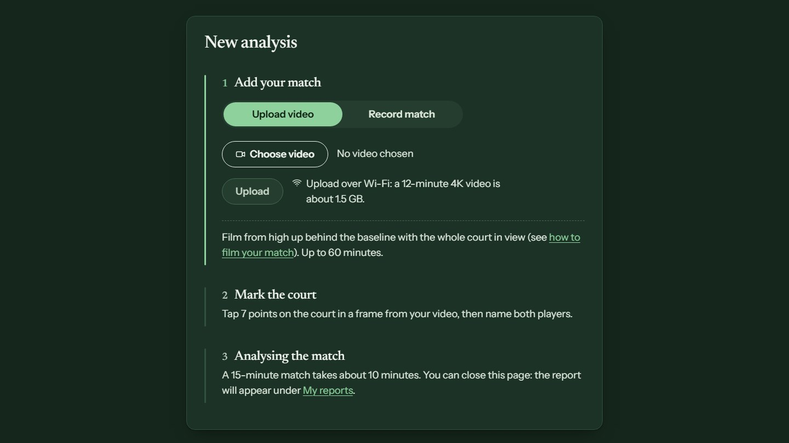
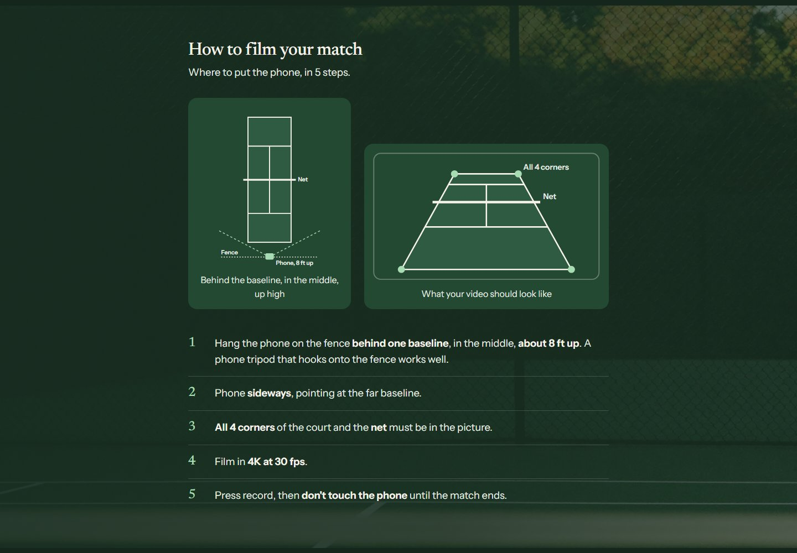
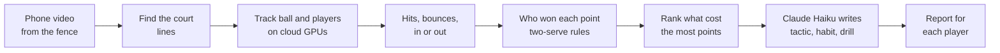

<div align="center">



# Advantage AI

**Turn match data into match wins.**

Upload a video of a singles tennis match. Each player gets a report that ranks what cost them the most points, with a tactic, a habit and a drill for each fix. It's made for junior and high school players and their coaches.

*Built by a player, for players.*

[**See an example report**](https://rudragoel10--tennis-perf-app-web-app.modal.run/report?job=76a383379d90) · [Open the app](https://rudragoel10--tennis-perf-app-web-app.modal.run)


-2F5D3A)


</div>

<p align="center">
  
</p>

## Why I built it

I built Advantage AI after losing a JV match for my high school team, because when it ended, I could not say what had actually gone wrong. My coach had not been at the match and nobody had recorded it, so neither of us could point to a single thing I should practice before the next one.

This problem is not only mine, of course. Not every player has a private coach, and on match day our school coach is watching several courts at once, so no one can see every point. Most players already own a phone, though, and almost every court has a fence to set it on. I wanted Advantage AI to turn that simple setup into a clear list of what to fix, so any player, including my teammates, can walk into practice knowing where their time should go.

## What it does

Using the app takes three steps, and the player only has to do the first two.

1. **Add your match.** Upload the video after the match, or use **Record match** to send it from your phone while you play.
2. **Check the court.** The app finds the court lines by itself and places the dots, so you only have to check them and name both players.
3. **Get the report.** For a 12-minute clip, the analysis takes about five minutes once the video is in.

Each player gets their own report, and it is built to be acted on right away:

- **Your #1 fix**, then the **top 3 things to fix**, ranked by how many points each one cost.
- A **tactic, habit and drill** for every fix, plus the **times in the video** where those points were lost.
- Points won, serves in, aces, double faults, shots per rally, and what to **keep doing**.
- **Save as PDF**, so a player can send the report to their coach before a lesson.

<table>
  <tr>
    <td width="50%"></td>
    <td width="50%"></td>
  </tr>
  <tr>
    <td align="center"><sub>The report opens on the player's #1 fix</sub></td>
    <td align="center"><sub>Every lost point is sorted, then ranked into the top 3 fixes</sub></td>
  </tr>
  <tr>
    <td width="50%"></td>
    <td width="50%"></td>
  </tr>
  <tr>
    <td align="center"><sub>Three steps: add the match, mark the court, wait</sub></td>
    <td align="center"><sub>A built-in guide for where to put the phone</sub></td>
  </tr>
</table>

## How it works



- **Ball detection.** From the fence, the ball is only a few pixels wide and often blurs into a streak, so ready-made detection models missed most of it. I trained my own **YOLOv8** model on about 1,400 frames I labeled, which brought its mAP50 for the ball to about 0.76, and I run it on full 2560-pixel frames because shrinking them dropped my scores by 6 to 10 points.
- **Ball tracking.** Standard trackers expect objects to move smoothly, so they kept losing a ball that changes direction at every hit and bounce. I built a linker that predicts where the ball should be next from its speed and direction, which also lets it ignore stray balls on the court.
- **Court mapping.** The app finds the court by masking the white paint, detecting straight lines, and testing pairs of lines against a model of a real court. From that fit, it computes a **homography** (a map from the video picture to a flat, top-down court in meters), so bounces and player positions are measured in real distances.
- **Points.** Hits and bounces show up as sudden changes in the speed of the ball. Every call I make without thinking as a player had to become a precise rule, like telling a serve toss apart from the actual serve, calling a ball in or out with a small tolerance, and applying the two-serve rule step by step.
- **Speed.** A 12-minute 4K video is about 1.5 GB, which is far too slow for one machine, so the app splits it into up to 10 pieces that run on cloud GPUs at the same time and merges the results before scoring.
- **Advice.** My code finds the patterns that cost each player the most points and ranks them. Then **Claude Haiku** turns only those patterns into clear, encouraging practice advice in plain words, and it never sees the video.

## Tech stack

| Part | What it uses |
|---|---|
| Website | HTML, CSS and JavaScript (no framework), works on phone and computer |
| Server | Python 3.12, FastAPI, hosted on [Modal](https://modal.com) |
| Detection | YOLOv8 (my own ball model, standard model for players), ByteTrack for players, OpenCV |
| Analysis | NumPy and pandas: court mapping, hit and bounce detection, scoring rules |
| Advice | Claude Haiku (Anthropic API), given only the patterns my code found |
| Uploads | Video sent in 16 MB pieces straight to cloud storage, so long videos keep going on weak Wi-Fi |

## Accuracy

To test the app, I labeled one full match by hand, point by point, and compared the calls of the app against my own labels.

- It picked the correct winner for **17 of 20 points (85%)**, and every winner it called was right. For the other 3 it called no winner rather than a wrong one.
- It named the right server for **every point it found**, which matters because the two-serve rule depends on knowing who is serving.
- The ball model was trained on frames from other matches, so this match was completely new to it, and **filming more matches for final validation is next**.

## What I'm improving

- **Testing on more matches.** I want to label matches on different courts, with different players and lighting, so the point calls keep getting more reliable.
- **Sharper calls at the far end.** A single pixel at the far baseline covers 5 to 10 centimeters, so I am working on making in and out calls there as exact as the near side.
- **Opening it to everyone.** While the app is in testing it uses a passcode, and the example report is already open for anyone to see.

The tips focus on tactics and practice, so the app works alongside a coach and gives every lesson a head start.

## Privacy

Since players are trusting the app with videos of themselves, I feel that protecting those videos matters as much as the analysis itself. Match videos are stored on the app's passcode-protected server, the AI that writes the tips only gets the numbers and never the video, and the **Delete report** button erases both the video and the report.

## What coaches told me

I showed the app to my coach, Adriana Ciarnuto, who has been teaching tennis for more than 30 years. She told me that coaches do not have time to watch even one of their players' matches fully, and that she thinks the app will help a lot of coaches and students. She and another coach both said that line calls would be one of the most useful features to add, since arguments over in or out calls happen at every level, from juniors to adults.

## What's next

1. **More accurate calls**, by testing on more matches, since every other feature depends on them.
2. **What coaches asked for:** line calls accurate enough to settle in or out arguments, second serve percentage, and serve speed.
3. **Progress across matches**, so a player can see which weaknesses are shrinking over a whole season, with the #1 fix turned into a simple focus for the week.
4. **A better way to film.** The tripod that clamps onto the court fence takes time to set up and doesn't give the best view for stats like line calls.
5. **Accounts and stronger privacy**, where each player signs in to see only their own reports and each video is deleted automatically once its report is ready.

## Project layout

```
modal_app.py            Web server, upload handling and the cloud pipeline (Modal)
calibration_demo.html   Home page: new analysis, court marking, My reports
report.html             Player report
camera_test.html        Checks what a phone camera records in the browser
web_assets/             Shared styles, header and footer, upload and Record match code, images
Code/                   Pipeline modules (court, tracking, events, scoring, profile, advice)
Code/test_*.py          Tests
Code/legacy/            My first pipeline, kept as history (not used by the app)
Training/               Ball-model training and evaluation scripts
design/                 Approved page designs and references (see DESIGN.md)
ground_truth_*.csv      My hand labels for the test match
```

## Running it

The app runs on [Modal](https://modal.com). You need a Modal account, the trained ball model on the Modal volume, and three Modal secrets: `app-passcode`, `anthropic` (Anthropic API key) and `r2` (cloud storage keys).

```bash
pip install modal
python -m modal deploy modal_app.py
```

Each test file runs on its own from the project folder, for example:

```bash
python Code/test_rally_outcomes.py
```

## License

[MIT](LICENSE) © 2026 Rudra Goel
