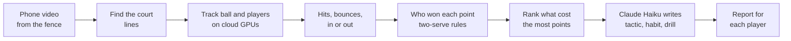

<div align="center">


# Advantage AI

**Turn match data into match wins.**

Upload a video of a singles tennis match. Each player gets a report that ranks what cost them the most points, with a tactic, a habit and a drill for each fix.

*Built by a player, for players.*

[**See an example report**](https://rudragoel10--tennis-perf-app-web-app.modal.run/report?job=76a383379d90) · [Open the app](https://rudragoel10--tennis-perf-app-web-app.modal.run)


-2F5D3A)


</div>

<p align="center">
  
</p>

## Why I built it

I lost a JV match for my high school team and, when it ended, I couldn't say what had gone wrong. My coach hadn't been there and nobody had filmed it, so neither of us could name one thing for me to practise.

Most players have the same problem. Not everyone has a private coach, and on match day our school coach is watching several courts at once. But almost every player has a phone, and almost every court has a fence to put it on. Advantage AI turns that simple setup into a short, ranked list of what to work on next.

## What it does

1. **Add your match.** Upload the video afterwards, or use **Record match** to send it from the phone while you play.
2. **Check the court.** The app finds the court lines by itself and places the dots. You check them and name both players.
3. **Get the report.** For a 12-minute clip the analysis takes about five minutes once the video is in.

Each player gets their own report:

- **Your #1 fix**, then the **top 3 things to fix**, ranked by how many points each one cost.
- A **tactic, habit and drill** for every fix, plus the **times in the video** where those points were lost.
- Points won, serves in, aces, double faults, shots per rally, and what to **keep doing**.
- **Save as PDF** to send to a coach before a lesson.

<table>
  <tr>
    <td width="50%"></td>
    <td width="50%"></td>
  </tr>
  <tr>
    <td align="center"><sub>The report opens on the player's #1 fix</sub></td>
    <td align="center"><sub>Every lost point is sorted, then ranked into the top 3 fixes</sub></td>
  </tr>
  <tr>
    <td width="50%"></td>
    <td width="50%"></td>
  </tr>
  <tr>
    <td align="center"><sub>Three steps: add the match, mark the court, wait</sub></td>
    <td align="center"><sub>A built-in guide for where to put the phone</sub></td>
  </tr>
</table>

## How it works



- **Ball detection.** Off-the-shelf models missed a ball that is only a few pixels wide and often blurred. I trained my own **YOLOv8** model on about 1,400 frames I labelled (mAP50 about 0.76 for the ball). It runs on full 2560-pixel frames, because shrinking them lost 6 to 10 points of accuracy.
- **Ball tracking.** Standard trackers expect smooth motion and lose a ball that changes direction at every hit. My linker predicts where the ball should be next from its speed and direction, which also lets it ignore stray balls on the court.
- **Court mapping.** The app masks the white paint, finds straight lines, and tests pairs of them against a model of a real court. The fit gives a **homography** (a map from the video picture to a flat, top-down court in metres), so bounces and player positions are measured in real distances.
- **Points.** Hits and bounces show up as sudden changes in the ball's speed. The app tells a serve toss from a serve, calls balls in or out with a small tolerance, and applies the two-serve rule step by step to decide who won each point.
- **Speed.** A 12-minute 4K video is about 1.5 GB, so it is split into up to 10 pieces that run on cloud GPUs at the same time, then joined before scoring.
- **Advice.** My code finds and ranks the patterns. Only those numbers go to **Claude Haiku**, which turns them into plain-language practice advice. It never sees the video.

## Tech stack

| Part | What it uses |
|---|---|
| Website | HTML, CSS and JavaScript (no framework), works on phone and computer |
| Server | Python 3.12, FastAPI, hosted on [Modal](https://modal.com) |
| Detection | YOLOv8 (my own ball model; standard model for players), ByteTrack for players, OpenCV |
| Analysis | NumPy and pandas: court mapping, hit and bounce detection, scoring rules |
| Advice | Claude Haiku (Anthropic API), given only the patterns my code found |
| Uploads | Video sent in 16 MB pieces straight to cloud storage, so long videos keep going on weak Wi-Fi |

## Accuracy, honestly

I labelled one full match by hand, point by point, and compared the app's calls against it.

- The app counted the near player's serves and faults exactly right: **9 serves, 5 faults**.
- It picked the right winner for **13 of 20 points**.
- The ball model was trained on frames from other matches, so this match was new to it. Some scoring rules were built while studying this same match, so **testing on more matches is next**.

## Limits

- Tested on one labelled match so far. A single missed bounce can flip a point, so point calls are the weakest part.
- Singles only. Doubles needs four players tracked.
- The phone has to be behind one baseline with the whole court in view (the app has a filming guide).
- Calls at the far end are less exact: one pixel there covers 5 to 10 cm of court.
- Tips cover tactics and practice, not stroke technique. It is made to work alongside a coach, not replace one.
- The app is passcode-protected while in testing. The example report is open to everyone.

## Privacy

Match videos are stored on the app's passcode-protected server. The AI that writes the tips never sees the video, only the numbers. **Delete report** erases both the video and the report.

## What's next

1. **Accuracy first:** film and label more matches on different courts, and keep some completely separate as test matches.
2. **Progress across matches**, so a player can see which weaknesses are shrinking over a season.
3. A weekly focus from the #1 fix, with practice tracking.
4. Easier use at the court: background uploads and a notice when the report is ready.
5. Accounts, and automatic video deletion once the report is ready.
6. Doubles.

## Project layout

```
modal_app.py            Web server, upload handling and the cloud pipeline (Modal)
calibration_demo.html   Home page: new analysis, court marking, My reports
report.html             Player report
camera_test.html        Checks what a phone camera records in the browser
web_assets/             Shared styles, header and footer, upload and Record match code, images
Code/                   Pipeline modules (court, tracking, events, scoring, profile, advice)
Code/test_*.py          Tests
Code/legacy/            My first pipeline, kept as history (not used by the app)
Training/               Ball-model training and evaluation scripts
design/                 Approved page designs and references (see DESIGN.md)
ground_truth_*.csv      My hand labels for the test match
```

## Running it

The app runs on [Modal](https://modal.com). You need a Modal account, the trained ball model on the Modal volume, and three Modal secrets: `app-passcode`, `anthropic` (Anthropic API key) and `r2` (cloud storage keys).

```bash
pip install modal
python -m modal deploy modal_app.py
```

Each test file runs on its own from the project folder, for example:

```bash
python Code/test_rally_outcomes.py
```

## How I used AI to build this

- I wrote about 60 percent of the code myself, then used **Claude Code** (Anthropic's coding assistant) to build on it and debug it.
- I labelled the training images with **Roboflow**. The three background photos on the website were made with an AI image generator.
- Inside the app, the ball detector is a YOLOv8 model I trained; it does not keep learning from uploaded videos. **Claude Haiku** writes the practice tips from my code's numbers only.
- The idea, what the report shows (ranking fixes by points lost), the look of the app, the filming, the labelling and the testing were mine.

**Prior work:** my first version of the pipeline is kept in [`Code/legacy/`](Code/legacy/) as history. It is not used by the app.

## License

[MIT](LICENSE) © 2026 Rudra Goel
